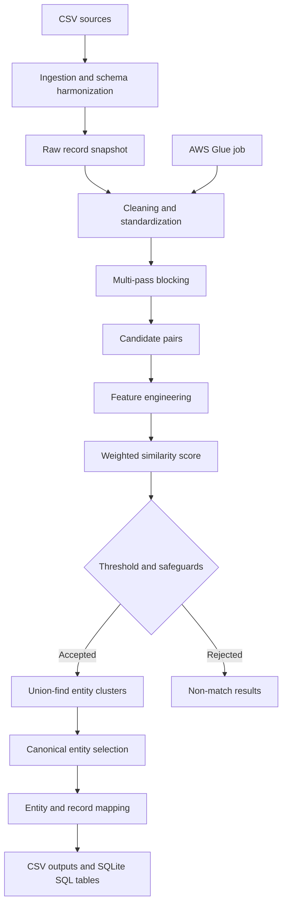

# EntityIQ – Intelligent Business Entity Resolution Pipeline

EntityIQ ingests business CSVs from multiple sources, standardizes identifiers, generates candidate pairs using multi-pass blocking, scores candidates, conservatively clusters duplicates, and writes CSV plus local SQLite outputs. Python, Pandas, NumPy and SQL form the local implementation. An AWS Glue/PySpark ETL job is included for AWS-managed execution.

> **Dataset note:** No business dataset was attached when this project was generated. The project therefore includes a deterministic synthetic-data generator (10,000 records / 5,000 known entity pairs). Replace it with your own CSV files to inspect and process a real schema. No real-world performance or AWS deployment is claimed.

## Architecture



## Project layout

- `src/`: ingestion, normalization, blocking, features, scoring, clustering, evaluation and pipeline.
- `config/config.py`: thresholds, weights and block limits.
- `sql/`: portable logical schema and analytics queries.
- `aws_glue/`: Glue 4/5 Spark ETL job.
- `tests/`: unit tests for core behavior.
- `generate_demo_data.py`: reproducible synthetic 10k-record dataset and labelled pair file.

## Requirements and local execution

Python 3.10+ recommended.

```bash
python -m venv .venv
# Windows: .venv\Scripts\activate
# macOS/Linux: source .venv/bin/activate
pip install -r requirements.txt
python generate_demo_data.py
python run_entityiq.py data/raw/businesses_a.csv data/raw/businesses_b.csv
python -m unittest discover -s tests -v
```

Outputs are written to `data/output/`:
`raw_records.csv`, `cleaned_records.csv`, `candidate_features.csv`, `matching_results.csv`, `resolved_entities.csv`, `record_entity_map.csv`, `run_metrics.json`, and `entityiq.db`.

## Input schema

The minimum useful field is business name. Supported aliases are defined in `src/ingestion.py`. Optional fields include address, phone, email, website, postal code, city, state and country. Each file is assigned a source label from its filename. Original values are retained in `*_raw` columns after standardization.

## Matching method

Blocking uses name prefix, name+postal, name+city, postal code, phone prefix and website domain. Pairs from multiple passes are deduplicated. Blocks larger than `max_block_size` are skipped to prevent quadratic blow-ups; inspect `blocking_stats` and tune this value for the data distribution.

Similarity features use sequence similarity and token Jaccard similarity for names/addresses, and exact-or-sequence comparisons for contact identifiers. A weighted score is the normalized weighted sum. Defaults: name 0.35, address 0.25, phone 0.18, email 0.10, website 0.12. Missing values contribute zero while the denominator remains fixed, so sparse records do not receive artificially inflated confidence.

Default thresholds: `>=0.94` Exact Match; `0.82–0.9399` Probable Match; below `0.82` Non-Match. These are starting values, not universal truths. Calibrate using a labelled validation sample and review false positives before production use. The clustering layer adds a name/strong-identifier guard and rejects pairs with conflicting populated phone AND email identifiers. Human review is recommended for probable matches and high-impact entities.

## Evaluation and honest metrics

`data/raw/ground_truth_pairs.csv` contains known duplicate record pairs for the synthetic demo. The evaluation module exposes pair-level precision/recall/F1 and blocking recall; it requires truth pairs to be loaded and mapped to the evaluated record IDs. The pipeline reports measured counts and elapsed time in `run_metrics.json`. It does not report precision/recall unless labelled truth is explicitly passed to the evaluation function. Synthetic benchmark results are not evidence of production accuracy.

## SQL

Local execution creates SQLite tables with the six requested logical datasets. Run queries from `sql/analytics.sql` against `data/output/entityiq.db`. `sql/schema.sql` documents a portable relational schema.

## AWS Glue

1. Upload input CSV files to an S3 prefix.
2. Create an AWS Glue 4.0 or 5.0 Spark job and upload `aws_glue/glue_etl_job.py`.
3. Set job parameters: `--INPUT_PATH s3://bucket/input/`, `--OUTPUT_PATH s3://bucket/entityiq-output/`, `--THRESHOLD 0.82`.
4. Grant the Glue role read access to input and write access to output.
5. Run and inspect the `standardized_records/` and `candidate_matches/` output prefixes.

The Glue script uses Spark for distributed CSV normalization, blocking and candidate scoring. It is a Glue starter path and intentionally does not claim feature parity with the local Python resolver: its similarity scoring is conservative/exact-field oriented, and its outputs are candidate match evidence, not final canonical clusters. Extend the Glue job with calibrated edit-distance scoring and distributed connected-components/entity aggregation before using it as a production resolver. No AWS deployment was performed as part of this deliverable.

## Configuration and scaling

Instantiate `MatchConfig` and pass it to `run_pipeline`. The local blocking stage is intended for 10k-scale datasets with moderate block sizes. Very large or skewed blocks are skipped, which improves runtime but may reduce recall; measure pair completeness against labelled data. For larger volumes, use Glue/Spark and partitioned S3 inputs. Avoid treating transitive similarity as proof of identity; use human review, business-specific constraints, and cluster-level consistency checks before operational merges.

## Tests

Run `python -m unittest discover -s tests -v`. Tests cover normalization, blocking, similarity primitives and entity grouping.


## Verified synthetic smoke-test (this build)

The generated 10,000-record dataset was processed locally. Observed values from this run:
- Records: 10,000
- Candidate pairs: 15,478 versus 49,995,000 possible all-pairs comparisons
- Candidate reduction ratio: 99.9690%
- Labelled true pairs: 5,000
- Pair completeness (blocking recall): 100.00%
- Accepted predicted pairs: 4,344
- Pair precision: 99.52%; pair recall: 86.46%; pair F1: 92.53%
- Resolved entities: 5,677
- Runtime: 30.30 seconds in the build environment

These are measured only on the included synthetic benchmark, whose duplicate variations are controlled and whose labels are known. They are not estimates of performance on an external business directory. The output files and SQLite database from this run are included under `data/output/`.
